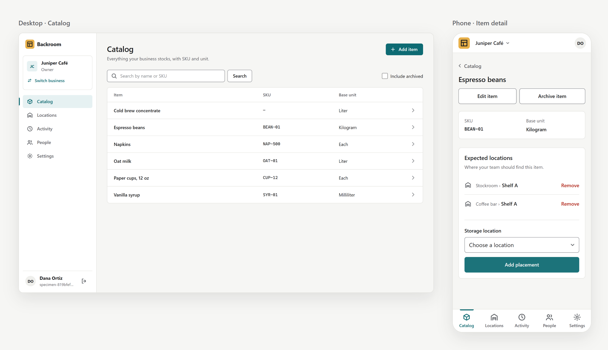

# Backroom design system

Version 3.1 · Coral · November 2026

Backroom is a work tool for small teams who need to find an item, see where it's kept and update it, often on a phone in a stockroom. Version 3 takes its layout and feel from [Sortly](sortly-inspiration.md), in Backroom coral instead of Sortly red: a coral navigation rail, crisp white cards on a cool gray canvas, photo-first item cards, folder-style storage and big circular actions on the item page. Records still carry the weight, coral still means "act here" or "you are here", and copy stays plain and sentence case.

[Component reference](design-walkthrough.html) · [Printable specimen](../output/pdf/backroom-design-specimen.pdf) · [Frontend codebook](frontend-codebook.md) · [Phase 1 product behavior](phase-1.md)

*The specimen image and the printable PDF predate version 3 and still show the teal design. The tokens and patterns on this page are current.*

## Principles

1. **Records first.** Item names, SKUs and locations carry the visual weight. Chrome (navigation, panels, labels) stays gray and light.
2. **One accent, one meaning.** Coral means "you can act here" or "you are here". The sidebar rail is the one large coral surface; inside the workspace coral appears only on actions, the current place and folder glyphs.
3. **Thumb-reachable on phones.** Navigation sits in a bottom tab bar; primary actions are full width under the page title; dialogs open as bottom sheets.
4. **Say what happens.** Buttons name the action (**Add placement**, **Archive**), messages say what changed and what to do next. No slogans, no marketing voice inside the app.
5. **Accessible by default.** WCAG 2.2 AA contrast, visible focus, 44 px touch targets, labels on every control, color always paired with words.

## Color

All values live as CSS custom properties in [`styles.css`](../frontend/src/styles.css). Use the token, never the hex.

| Token | Value | Use |
| --- | --- | --- |
| `--bg` | `#F4F5F7` | Cool gray canvas behind cards |
| `--surface` | `#FFFFFF` | Cards, tables, header bar, dialogs, inputs |
| `--surface-sunken` | `#EEF0F3` | Neutral badges, photo placeholders, hover on ghost controls, read-only fields |
| `--text` | `#111827` | Headings, record names, body |
| `--text-muted` | `#636975` | Descriptions, SKUs, table headers, metadata |
| `--text-subtle` | `#9CA3AF` | Placeholders, disabled text, chevrons only — never for information |
| `--border` | `#E5E7EB` | Card edges and row dividers |
| `--border-strong` | `#80868F` | Input and secondary-button edges |
| `--accent` | `#C2331F` | Primary buttons, links, active tab on phones, focus ring, folder glyphs |
| `--accent-hover` / `--accent-pressed` | `#A82B1A` / `#8E2415` | Primary button states |
| `--accent-soft` | `#FDECE8` | Folder tiles, outline-button hover, alerting metric icons |
| `--sidebar-bg` | `#D63F2A` | Desktop navigation rail and the phone top bar |
| `--sidebar-surface-active` / `--sidebar-surface-hover` | `rgb(0 0 0 / .18)` / `rgb(0 0 0 / .10)` | Darker coral pill for the current and hovered destination |
| `--sidebar-text` / `--sidebar-text-muted` | `#FFFFFF` / `rgb(255 255 255 / .9)` | Labels and icons on the rail |
| `--brand-mark` / `--brand-ink` | `#FFFFFF` / `#C2331F` | Logo mark only |
| `--success` / `--success-soft` | `#1F6B3A` / `#E7F3EB` | Confirmations, In stock and Active badges |
| `--warning` / `--warning-soft` | `#8A4B0F` / `#FCF0E0` | Low and Archived status, pending invitations |
| `--danger` / `--danger-soft` | `#8F1D3F` / `#FBE9EF` | Errors, destructive buttons. Plum so a destructive confirm never looks like the coral primary |

**Measured contrast** (WCAG 2 relative luminance, rechecked November 13, 2026): text on surface 17.7∶1, muted on surface 5.5∶1, muted on canvas 5.1∶1, muted on sunken 4.8∶1, white on accent 5.5∶1, white on the sidebar 4.6∶1, white on danger 8.7∶1, accent on its soft tint 4.8∶1, control edge on canvas 3.4∶1, each feedback color on its tint ≥ 5.7∶1.

Muted was darkened from `#6B7280` to `#636975` in 3.1 because the old value measured 4.4∶1 on the canvas, under AA for the page descriptions that sit there. Recheck all three backgrounds when changing it.

Rule of thumb: apart from the rail, about 90% of any screen is `--bg`, `--surface` and text grays. The accent fills at most one button per group of actions; companions use the coral **outline** or white **secondary** style.

## Type

System UI fonts (San Francisco, Segoe UI, Roboto) load instantly and look native on staff devices. Monospace for SKUs and codes. `tabular-nums` for dates, counts and any future quantities.

| Role | Size / line height | Weight |
| --- | --- | --- |
| Page title | 24 / 32 px desktop, 20 / 28 px phone | 600 |
| Dialog title | 20 / 28 px | 600 |
| Section title | 16 / 24 px | 600 |
| Body, table rows, buttons, labels | 14 / 20 px | 400; labels, buttons and record names 600 |
| Form inputs | 16 / 24 px on touch and below 1024 px (stops iOS zoom), 14 / 20 px on desktop | 400 |
| Supporting text, hints, table headers | 13 / 20 px | 400; headers 600 |
| Badges, tab labels | 12 / 16 px | 600 / 500 |

Record names on cards and rows are 16 px bold, item titles 28 px bold. Nothing in the product is smaller than 12 px, except the 10 px **New** corner pill. Uppercase tracked labels are limited to the item fact labels (SKU, Updated) and the **Administration** rail heading.

## Space, shape and depth

- **Spacing:** 4 px scale — 4, 8, 12, 16, 20, 24, 32, 48. Page gutters 16 px phone, 24 px tablet, 32 px desktop.
- **Radius:** 8 px controls, 10 px cards, panels and dialogs, 14 px on the item photo stage and phone sheets, fully rounded badges, switches, view toggle and circular actions.
- **Depth:** cards use a 1 px border plus `--shadow-card` (a 1 px soft lift) so white cards read on the gray canvas. Only overlays (dialogs, menus) get `--shadow-overlay`.
- **Targets:** controls are 36 px tall with a mouse, 44 px on touch screens and anything narrower than 1024 px. Table rows are at least 52 px, phone rows 56 px.
- **Motion:** 120 ms color transitions on controls, 160 ms fade/slide for dialogs and sheets. Everything is off under `prefers-reduced-motion`.

## Icons

Inline SVG set in [`icons.tsx`](../frontend/src/icons.tsx): 20 px box, 1.75 px round stroke, `currentColor`. Icons are decorative and always sit beside a visible word, except the sheet close button and the sign-out button in the sidebar, which carry an `aria-label`. Don't use emoji or Unicode symbols as icons.

## Layout and navigation

| Width | Navigation | Content |
| --- | --- | --- |
| 1024 px and wider | 232 px **coral rail**: white logo, translucent business card (name, role, **Switch business**), destinations with thin 1.6 px white icons, account block with **Sign out** at the bottom. The current destination is a darker coral pill in bold white; no leading bar. A 56 px white header bar beside the rail holds the global search. | Max 1120 px, 32 px gutters. Breadcrumbs, then the title row (title, description, actions on the right), then search, summary strip and controls, then records. |
| Under 1024 px | 56 px sticky **coral** top bar: white logo, business name (opens the business list), account button (name, email, **Switch business**, **Sign out**). 64 px fixed white **bottom tab bar** with icon over label; the current tab is coral with a 3 px top bar. | 16 px gutters on phones, 24 px on tablets. Bottom padding clears the tab bar and the home indicator. |

Tabs are filtered by role, so the bar never needs a "More" item:

| Role | Destinations |
| --- | --- |
| Employee | Home, Inventory, Scan, Requests, Locations |
| Manager | Home, Inventory, Scan, Requests, Locations |
| Owner | Home, Inventory, Scan, Requests, Locations |

Every role gets the same five tabs, with the most frequent first. Less frequent pages live in the account menu on phones and in an **Administration** group under the main navigation on desktop, filtered by role:

- **Activity** and **Export data**: Owners and Managers.
- **People** and **Business settings**: Owners only.

On desktop the global search sits in the white header bar, outside the page content; on phones the search field is on Home. The Requests tab carries a count badge: requests waiting for review (managers) or approved requests waiting for delivery (employees).

Detail pages show a back link above the title. It returns to where the person came from (**‹ Back to House espresso**, **‹ Back to search results**, **‹ Back to scan result**), restoring that list's filters, page, scroll position and the row they opened. Opened directly, it falls back to **‹ Inventory**, **‹ Requests** or **‹ All locations**. A location's parent is a separate link beside its type badge ("In Stockroom"), so physical hierarchy and the way back never compete. Inventory keeps its search, filters and page in the address. A "Skip to content" link is the first focusable element.

## Components

| Component | Variants and rules |
| --- | --- |
| **Button** | `primary` (coral, bold, one per action group), `outline` (coral text and edge on white, for a second creation action such as **Import items** or **Add child location**), `secondary` (white, strong border), `ghost` (no border, for low-priority header actions), `danger` (only to confirm a destructive action). Label is a verb + noun. A leading plus icon replaces "+ " in text. Pending state renames the label (**Saving…**, **Adding…**) and disables it. |
| **Text button** | Inline row actions (**Remove**, **Revoke**, **Remove access**). Danger tone for removals. |
| **Field** | Label above control, optional hint below, inline error below that with `aria-invalid`. Labels are nouns ("Business name"), hints are one sentence. |
| **Search** | Search icon inside the field, **Search** button beside it, **Include archived** checkbox at the end of the toolbar. Full width on phones. Browse pages add the inline scan button (see Folder explorer patterns). |
| **Data table** | White panel, header row in muted 13 px, 52 px rows, whole row clickable through the name link, chevron at the end. Under 640 px each row restacks: name (+ Archived badge) on line one, `SKU · Unit` muted on line two. Absent SKU reads "No SKU". |
| **Record list** | Simple divided rows inside a panel for short lists (expected locations). Shows the parent name before the location: "Stockroom › **Shelf A**". |
| **Badge** | Neutral (roles, types, Archived in lists), success (Active member), warning (Archived on a detail page, pending invitation), danger. Ordinary active items get no badge. |
| **Notice** | Inline error (`role="alert"`, danger tint, **Try again** when a read failed) and success (`role="status"`, success tint). Sits at the top of the panel it belongs to. |
| **Empty state** | Icon tile, plain title, one sentence on what to do next, optional action that isn't already in the page header. |
| **Dialog** | Title states the question for confirmations (**Archive Espresso beans?**). Centered 512 px card on desktop; bottom sheet on phones with a sticky action row. Background is inert, Escape closes, focus returns to the trigger. Destructive dialogs focus **Cancel** first and confirm with a danger **Archive** / **Remove**. |
| **Loading** | Skeleton rows inside the panel for lists; short text elsewhere. Empty results only show after a successful load. |
| **Pager** | "Page 2 of 5" on the left, **Previous** / **Next** on the right, inside the panel footer. |

## Stock patterns

| Pattern | Rules |
| --- | --- |
| **Quantity** | Always show the unit beside the number (`12.5 kg`, `24 L`; Each shows the number alone). `tabular-nums`, right-aligned in tables. Changes carry a sign (`+6 kg`, `−0.75 kg`); additions use the success color, removals stay in body text. |
| **Quantity field** | Label includes the unit: "Quantity (kg)". Numeric keypad for Each, decimal keypad otherwise. Hint states what's available when removing or moving stock. |
| **Stock by location** | Table of `Parent › Location` with the on-hand quantity. Each row offers its everyday action as a button, **Record usage** when there is stock or **Receive stock** when there is none, and a **More actions** text button. Both carry the location in their accessible names. A location's **Expected items** rows work the same way, named by item; on shelves and bins that table comes before child storage. On phones the row restacks to name, then "15 kg on hand", with the actions wrapping below. |
| **Location action sheet** | **More actions** opens a sheet titled with the location path. It lists only the actions the person's role allows: Record usage, Record waste, Receive stock here, Request more here, plus Transfer from here, Count, Set starting quantity and Set minimum for managers. A one-line hint sits under less obvious actions. |
| **Choosing the shelf** | Usage and waste never guess. Opened from a row, a scan with a shelf, or an item stocked on only one shelf, the sheet shows "From Stockroom › Shelf A · 12 kg available" and focuses Quantity. When several shelves hold the item and none is known, **From** starts on "Choose a shelf" and must be set. |
| **Item header** | **Record usage** (primary) when the item has stock, then **Receive stock**, **Request more** and, for managers, **Transfer**. **Edit item** and **Archive item** live in a **Manage item** section at the end of the page, away from daily actions. |
| **Stock sheet** | One sheet per operation, titled with the action ("Record usage"). The submit button repeats the title. The success message names the amount and place, and what is left there after a removal: "Used 2 kg from Stockroom › Shelf A. 10 kg on hand there." Server errors appear inline in the sheet, and the form keeps its values for a retry. |
| **History** | Newest first. Each row has an icon tile and a past-tense title (Received, Used, Wasted, Moved out/in, Count adjustment, Starting quantity, Reversal), then `place · person`, any note or reference, the signed change, the balance after, and the time. Reversed operations carry a **Reversed** badge. Managers see **Reverse** under reversible rows; it appears once per transfer. |

## Scanning and label patterns

| Pattern | Rules |
| --- | --- |
| **Scan page** | Camera panel and result column side by side on desktop, stacked on phones. The camera never starts on its own; **Start camera** asks for permission. A white rounded aim frame over a dimmed preview. Manual entry ("Type a code or barcode") is always visible. |
| **Result card** | Left border in the accent color for a found item or location, warning color for anything that needs attention. Kicker line names the type and the code in monospace. Primary action **Open item** / **Open location**, plus **Record usage** and **Receive** for items. **Scan again** sits under the card at full width. |
| **Camera problems** | One error notice per cause (denied, no camera, needs HTTPS, failed to start), each saying what to do next. Never a dead end: manual entry stays usable. |
| **Labels and barcodes panel** | On item and location pages. One row per active code (QR label, product barcodes) with the code in monospace. Managers see **Print label** / **Create label**, **Withdraw** / **Remove** (danger, confirmed) and an **Add a product barcode** field. Withdrawn codes are listed once, muted. |
| **Print labels** | Label previews at true aspect ratio on white (a label is paper, even in dark mode). Paper choice as large radio cards, start position, and three numbered print steps including the calibration page. A warning notice while labels would point to a local address. |
| **Selection mode** | **Print labels** on the Inventory and Locations lists switches rows to checkboxes, with a tinted bar showing the count and **Print N labels**. |

## Request patterns

| Pattern | Rules |
| --- | --- |
| **Filter chips** | A horizontal row of pill buttons above the list (`aria-pressed`). Managers start on **Needs review**, employees on **To receive**. The active chip is filled with the accent color. On phones the row scrolls sideways inside itself. |
| **Request row** | `R-12` in muted monospace, then the item name. Second line: destination path and progress ("4 of 6 L received"). Third line: requester and relative time. Status badge on the right: Submitted (warning), Approved and Partly received (accent), Received (success), Rejected, Cancelled and Closed short (neutral). |
| **Request detail** | Title `R-12 · Item`. Quantities strip: Requested / Approved / Received / Still expected. A details panel with links to the item and location, then a timeline: requested, decided, each delivery (reversed ones struck through with a note), closed. Primary action is **Record delivery** while stock is expected; managers also see **Approve**/**Reject** or **Close short**. |
| **Decision sheets** | The title asks the question ("Approve R-1?", "Close R-2 short?"). Approve pre-fills the requested quantity and says it can't be changed later. Reject and Close short need a reason and use the danger button. Delivery pre-fills what is still expected. |
| **Duplicate warning** | The new-request sheet lists open requests for the same item and location in a warning notice, and the submit button changes to **Submit anyway**. |

## Home and low-stock patterns

| Pattern | Rules |
| --- | --- |
| **Home** | Opening a business lands here. Owners and Managers: the metric cards first, then search with **Scan**, the **Spaces** folder cards, then **Requests** beside **Low stock** on desktop (one column on phones), **Request stock**, setup and **Recent activity**. Employees: search with **Scan** (primary) first, the metric cards, **Spaces**, then **My requests** and **Low stock**. Low-stock rows lead with a small item tile. Cards are table panels: a header with a title, a one-line description and a text link (**See all low items**, **Open requests**, **All activity**). |
| **Setup checklist** | Numbered steps, each with a round mark: empty, accent ring for the next step, or filled success with a check when done. Done steps turn muted. Only the next step has a primary button; the rest are secondary. A new business sees it expanded at the top. Once there is stock or a request to review it collapses to "Continue setup · 2 remaining" below the work, with **Expand**/**Collapse**. **Download a label** is ticked only after a label PDF downloads. |
| **Metric cards** | Sortly dashboard cards, four across on desktop and 2×2 on phones: a round icon, a large bold number and its label ("3 Needs review"). Owners and Managers see **Needs review**, **Low stock**, **Total items** and **Spaces**; employees **To receive**, **Total items** and **Spaces**. The icon turns coral-tinted when the count needs attention. Each card links to the list that shows exactly those records. **Low stock** counts items, like the Inventory "Low stock only" list it opens. A count that failed to load shows "–" with the error above, never 0. |
| **Minimum note** | Under the location name on a stock row: a **Low** warning badge (only when low), then "Min 5 L" in muted small text. The slot sheet subject adds "· min 5 L". |
| **Low row** | Item name (link), location path, then "**3 L** of 5 L · short 2 L" with the current quantity in warning color. On the right: **Request** (secondary, prefilled with the shortfall) or "R-12 open" linking to the request that already covers it. |
| **Search results** | A **Code match** first, as an accent-tinted card with the target's icon. Then **Items** and **Locations** panels, each saying how many matched, or "First 8 matches" when capped. |
| **Export cards** | Two per row on desktop, one on phones. Each card has a title, one sentence saying what the file contains, From/To date fields for history files, and a secondary **Download CSV** button. A note under the cards says times are UTC and states the 50,000-row limit. |
| **Reset link dialog** | Mirrors the invitation dialog. A confirm step explains what happens. Then a read-only link field with "it won't be shown again" help and **Copy link** (primary). |

## Browse patterns

| Pattern | Rules |
| --- | --- |
| **View toggle** | A labelled group of two `aria-pressed` buttons, **Grid** and **List**, each with an icon. It sits at the end of the filters band. It is a rounded pill; the pressed half is filled coral with white text. Phones start in Grid and wider screens in List; the person's choice is remembered per browser and surface. Filters, search, paging and selection never reset on a switch. |
| **Visual tile** | The photo when there is one, filling the tile with `object-fit: cover`. Otherwise a `--surface-sunken` tile with up to two initials and a small kind icon in the corner (unit for items: box, weight, drop; type for locations: room, shelf, cabinet, bin). Never accent-colored, and always decorative, because the name beside it carries meaning. Sizes: `sm` 40 px in compact lists, `row` 56 px in item rows, `md` 4:3 in cards, `lg` 96 px, `hero` on the item photo stage. Items created in the last day carry a black **New** corner pill. |
| **Browse card** | Tile, then the SKU kicker in muted mono ("No SKU" when absent), then the record name as a 16 px bold link, then facts ("**12 kg** on hand" or "2 locations · 12 items"), then badges, then any stock actions. The card is not itself a link, so its buttons stay separate targets. Grid columns use `auto-fill, minmax(12rem, 1fr)` on desktop, two on phones, one under 352 px. Selected cards get an accent outline; archived cards dim their tile. |
| **Breadcrumbs** | On location pages, above the title: **All locations › Stockroom › Shelf A**. Earlier steps are links; the last is `aria-current="page"`. Separators are drawn in CSS, not read out. The contextual back link, when present, sits above the trail: "where you came from" above "where this is". |
| **Leaf location** | When a location has nothing stored inside it, one quiet line ("No storage inside Shelf A.") replaces the child search and empty state. **Add item here** becomes its primary action, and **Add child location** turns secondary. |
| **Short add** | Creating asks for name and unit. SKU sits under an **Optional details** disclosure in the accent link color. Editing shows every field. |
| **Item hero** | Sortly's detail layout. A white photo stage (square on desktop, 4:3 on phones) on the left, with a round **Labels and barcodes** pill in its corner that scrolls to that panel; **Add photo / Change photo** and **Remove photo** sit under it for Owners and Managers. On the right: a folder kicker with the item's shelf ("Stockroom › Shelf A", a link when there is exactly one, otherwise "2 locations" or "Not placed yet"), the 28 px bold title, then **SKU** and **Updated** (latest movement, or when it was added) as two small fact columns. Under 1024 px everything stacks, photo first. |
| **Circular actions** | A row of 48 px round buttons with the label underneath: **Record usage** (filled coral when there is stock), **Receive stock** (filled when there is none), **Transfer** (managers, when stocked), **Request more** and **History** (scrolls to and focuses the History heading). The visible label is the accessible name. |
| **Metric grid** | A hairlined 2×2 card under the actions, still a `<dl>`: **On hand** (28 px bold, with a −/+ pill that opens Record usage or Receive stock), **Min level** (bell icon; the minimum, "N shelves", or "Not set"), **Base unit**, and **Status** (In stock, Low, No stock or Archived). Stock by location, requests, labels and history follow as cards. |
| **Spaces strip** | On Home, up to six top-level rooms as folder cards (folder tile, bold name, contents) with **All locations** at the right of its heading. It never shows counts that aren't real and is hidden until a location exists. |
| **Sold** | **Record sale** sits in **More actions** after waste, with the hint "Sold to a customer; no prices are kept". Its history title is **Sold** with a tag icon. The confirmation follows the removal pattern. |

## Folder explorer patterns

Inventory and Locations share Sortly's explorer layout. Storage locations read as folders; items read as photo cards.

| Pattern | Rules |
| --- | --- |
| **Explorer header** | Breadcrumbs above the title: **All items** (Inventory, with the filtered location after it) or **All locations › Stockroom › Shelf A**. Actions sit on the right: one filled coral creation action (**Add item**, **Add location**, or **Add item here** on a leaf), a coral **outline** companion (**Import items**, **Add child location**), then secondary actions. |
| **Explorer search** | Full width with a leading search icon and a coral **Scan a label** icon button inside the field's right edge, linking to Scan. The **Search** button stays beside it. |
| **Summary strip** | A thin `<dl>` under the search with hairline separators: Inventory shows **Folders**, **Items** and **Low stock**; a location shows **Folders**, **Items here** and **Type**; the Locations root shows **Folders**. Counts come from real queries; a count still loading shows "–". |
| **Controls row** | On Inventory, divided from the summary by a hairline: the **Show folders** pill switch (`role="switch"`, remembered per browser), the location filter, **Low stock only**, **Include archived**, then at the end the **Sort items** select (Name A–Z, Name Z–A, Newest first; `?sort=` in the address and the API) and the Grid/List toggle. |
| **Folder card** | A horizontal white card: a 56 px coral-tinted folder tile with the location's kind icon in its corner, the bold name, and contents ("2 locations · 12 items" or "Empty"). The whole card is the link's hit area. Inventory shows top-level folders in a **Folders** band above the items when Show folders is on and nothing is filtered; locations show their children as folder cards in Grid. Phones fit two per row. |
| **Item row** | List view keeps a real table. Each row: 56 px thumbnail (with **New** pill), SKU kicker, 16 px bold name with badges, the unit, then the bold on-hand quantity with "on hand" on the right. |

## Import patterns

| Pattern | Rules |
| --- | --- |
| **Choose a file** | A short sentence on what a row is, a small column table (Column · Needed? · Example), limits in help text, then **Choose a CSV file** (primary, upload icon) beside **Download template**. Nothing is saved at this step. |
| **Review** | Titled "Review catalog.csv". A row of count badges: new (success), already exist (neutral), possible duplicates (warning), with problems (danger), new locations (accent). Then the locations to be created (open when five or fewer) and one line of help per kind of skip. The primary button states the result: **Import 3 rows** (disabled as **Nothing to import**). **Choose another file** restarts. |
| **Rows table** | Line (the spreadsheet's own number), item with SKU and unit, place with "12 to start · min 4", status badge with its reason underneath (problem reasons in danger text). Possible duplicates get an **Include** checkbox; included rows switch to a success **Included** badge. On phones each row restacks with a "Line 4" label. |
| **Result** | **Import finished**, a success notice, and a short list of non-zero counts ("3 items created", "2 rows skipped as duplicates"). Actions: **Open Inventory** (primary), **Open Locations**, **Import another file**. A replayed import says nothing was added twice. |

## Writing

- Sentence case everywhere. Name things the way a café or shop would: items, locations, shelves, people.
- Page descriptions say what the page holds, in under ten words ("Everything your business stocks, with SKU and unit.").
- Buttons: verb + noun. Confirm buttons repeat the verb from the title (**Archive Espresso beans?** → **Archive**).
- Errors say what went wrong and what to do: "Couldn't add Shelf A. Check your connection and try again."
- Empty states tell the person what to do next, or where the content will come from if they can't add it.

| Moment | Copy |
| --- | --- |
| No items, editor | **No items yet** · "Use Add item to create your first one and choose the unit you count it in." |
| Usage recorded | **Used 2 kg from Stockroom › Shelf A** |
| Count | **Counted 15 kg at Stockroom › Shelf A. Adjusted by −0.25 kg.** (or "It matched.") |
| Not enough stock | "There isn't enough stock at this location for that." |
| Reverse a receipt | **Reverse this receipt of 10 kg?** · "Backroom records the opposite movement, so the history shows both." |
| No items, employee | **No items yet** · "Items your team adds will appear here." + **View locations** |
| No search results | **No items match "espresso"** · "Check the spelling, or search by SKU instead." + **Clear search** |
| Placement added | **Stockroom › Shelf A added** |
| Archive item | **Archive Espresso beans?** · "Its expected locations are removed from active use. You can still find it with Include archived, and its history stays available." |
| Remove member | **Remove Sam Lee?** · "They will lose access to Juniper Café right away. Their past activity stays in the history." |

## Research behind the decisions

**Primary UI/UX inspiration:** Sortly — see [Sortly → Backroom design system & UX rules](sortly-inspiration.md) (photo-first browse, space navigation, grid/list, short add flows; adapted for physical spaces, stock actions, and attention).

| Product | Observed workflow | Decision for Backroom |
| --- | --- | --- |
| Sortly | Search can show a folder path, and one item can appear in several folders. | Show the parent name with each expected location so two "Shelf A" entries are distinguishable, in the list and in the picker. [Sortly item locations](https://help.sortly.com/view-item-locations-in-sortly) |
| Square for Retail | Archived items are hidden but found again through a status filter. | Keep **Include archived** in the catalog toolbar and label archived rows. [Square item archival](https://squareup.com/help/us/en/article/8060-archive-items-with-square-for-retail) |
| MarketMan | Teams count stock by storage area on mobile. | Give Locations equal weight with Catalog in the tab bar. For future counts, keep shelf and unit visible while entering a quantity. [MarketMan inventory workflows](https://www.marketman.com/page/food-service-management-software) |

## Version history

| Version | Change |
| --- | --- |
| 1 | Neutral canvas with one teal accent, border-first panels (Phases 1–5). |
| 2 | Browse patterns: visual tiles, grid/list, breadcrumbs, short add, item photos, Sold, import ([Phase 6](phase-6.md), [Phase 7](phase-7.md)). |
| 3.0 | Sortly-style folder explorer, dashboard Home and item hero, in a crimson accent and rail with a plum danger color. |
| 3.1 | Crimson replaced by Backroom coral (`#C2331F` accent, `#D63F2A` rail); plum danger kept so destructive actions never look like the primary. |

The five tabs are settled: Inventory, Scan and Requests shipped, and **Activity**, **Export data**, **People** and **Business settings** live under **Administration** (desktop) or the account menu (phones), so the bar never needs a sixth item.
